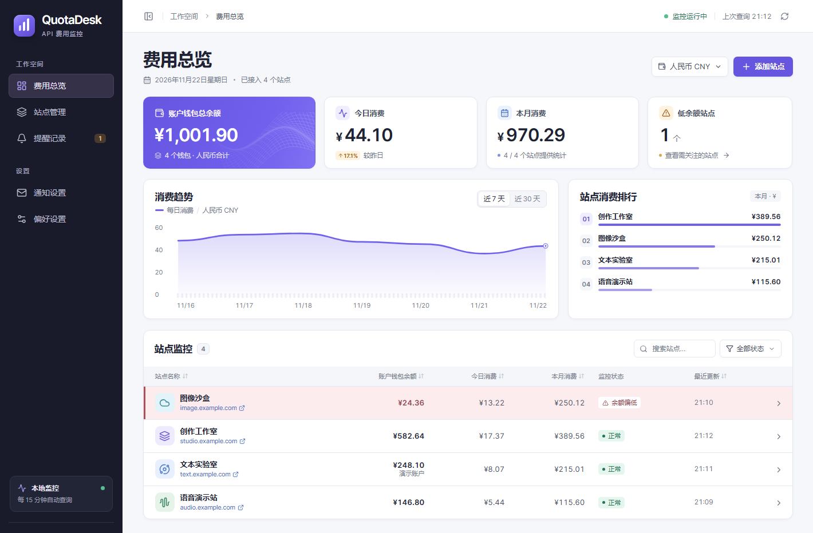
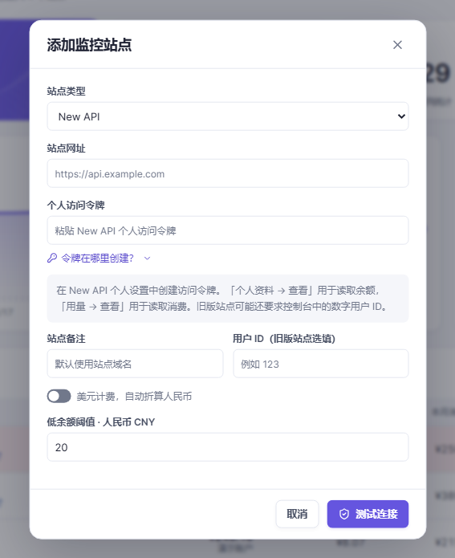
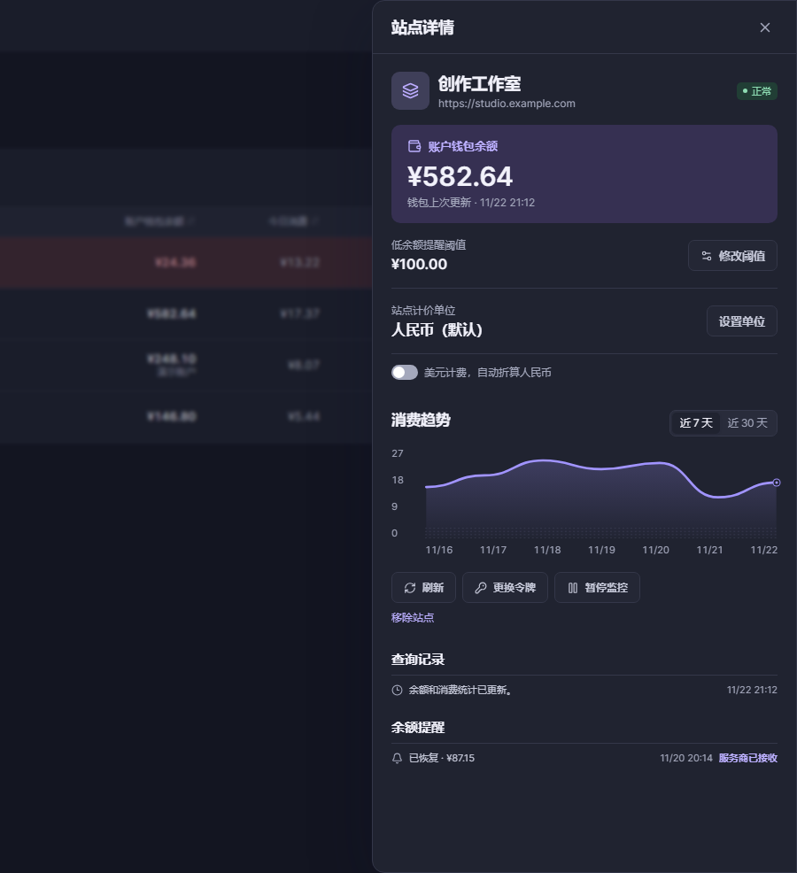
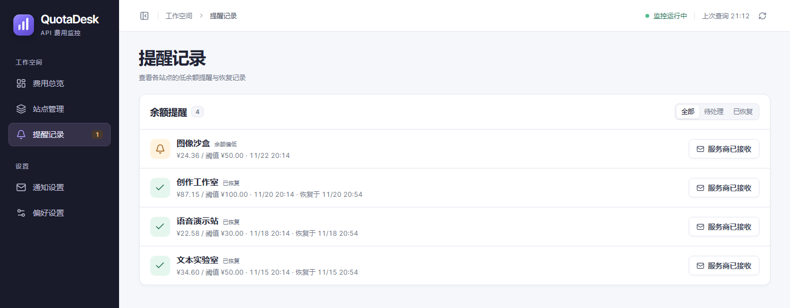

# QuotaDesk

QuotaDesk 是一款 Windows 桌面端 API 费用监控工具。把 New API 账户和 SUB2API Key 接入同一个工作区，就能查看各站点的钱包余额、今天和本月的消费。首次低余额通过邮件提醒，持续低余额可通过 Flashduty 追加短信。关闭主窗口后，监控会在系统托盘继续运行。



文中截图来自 QuotaDesk 的实际界面，站点、金额和提醒记录均为虚构示例。

## 在 Windows 上运行

安装 Git 和 Node.js。以下命令在 Windows x64、Node.js 22.22.2 和 npm 10 下验证。

```powershell
git clone https://github.com/yuanxiao9889/newapi--.git QuotaDesk
cd QuotaDesk
npm ci
npm start
```

也可以下载并解压本仓库的 ZIP，安装 Node.js 后双击根目录的 **运行开发版.cmd**。首次启动时脚本会安装依赖，随后打开桌面窗口。

## 接入第一个站点

1. 在「费用总览」点击 **添加站点**，选择站点类型，填写站点的 HTTPS 地址。如果服务部署在子路径下，请保留该路径。
2. 按下表填写凭据。可以给站点起一个容易辨认的备注名，方便在总览中查找。
3. 设置低余额阈值。填 `0` 可关闭该站点的余额预警。如果站点以美元计费，可打开「美元计费，自动折算人民币」，并在站点无法提供汇率时填写备用汇率。
4. 点击 **测试连接**，核对返回的余额、单位和统计可用性，然后点击 **保存站点**。

| 类型 | 需要填写 | 如何读数 |
| --- | --- | --- |
| New API | 在站点的个人设置中创建个人访问令牌。「个人资料 → 查看」用于读取余额，「用量 → 查看」用于读取消费。旧版站点可能还需要数字用户 ID。 | 余额和消费统计分别读取。只有余额权限时，仍可监控钱包。 |
| SUB2API | 填写站点提供的 API Key。同一站点、同一账户的多把 Key 使用同一账户分组，不同账户分别命名。 | 要查看账户钱包，组内至少接入一把按钱包计费且没有 Key 总额度或周期限额的 Key。同组钱包只汇总一次，Key 限额可在详情中查看。 |
| 自定义余额接口 | 选择 TokenMei 预设并填写 API Key。其他服务可手动配置 GET 地址、Bearer 或 X-API-Key 鉴权、JSON 余额字段（例如 `data.balance`）和币种。 | 定时查询余额、估算今日消费并提供低余额提醒。TokenMei 的主账户 Key 读取主账户余额，子账户 Key 读取该子账户额度。同一钱包只需接入一把 Key。 |

<details>
<summary>查看添加站点界面</summary>



</details>

## 查看余额、消费和提醒

今日消费优先使用平台的当日实扣。缺少日统计时，以昨天最后一次成功查询为起点，按累计用量的增量或账户余额的下降额估算。首次接入或中间缺了一整天时，从当天第一笔记录开始。两次查询之间同时发生充值和消费时，只能从余额看出净变化。SUB2API 优先统计各把 Key 的消费；同组所有 Key 都缺少当日数据时，共享账户的余额估算只计一次。

- **费用总览**以人民币汇总已读到的钱包余额。右上角的单位选择器可切换消费统计的计价单位。趋势图支持近 7 天和近 30 天，排行按本月消费排列。消费栏的「—」表示该时段暂无统计。
- **站点管理**可以按名称或域名搜索，按状态筛选。点击站点名称进入详情，可查看最近查询、调整阈值或暂停监控。需要统一管理时，点击页面右上角的「统一预警金额」覆盖单站规则。
- **通知设置**支持 SMTP 或 Resend。启用邮件提醒，填写服务凭据、发件邮箱和收件邮箱。多个收件人可用逗号或分号分隔。点击「发送测试邮件」验证配置，再点击「保存设置」。
- **Flashduty 短信告警**配合邮件提醒使用。在「通知设置」粘贴自定义事件的完整 HTTPS 集成地址，在对应协作空间将 Warning 告警分派给自己的手机并启用短信。发件服务确认接收本轮告警邮件后，下一次成功的自动查询若仍低于阈值，才推送短信事件。同一轮持续低余额只提醒一次，余额恢复后再次跌破阈值会重新从邮件开始。「发送测试事件」可直接验证短信通道。
- **提醒记录**保留低余额和恢复时间。同一轮低余额会沿用一条提醒。点击投递状态可查看邮件详情。「服务商已接收」表示发件服务已接受该邮件。

<details>
<summary>查看站点详情和提醒记录</summary>





</details>

## 后台监控与换机

「偏好设置」可切换浅色、深色或跟随系统，并将查询间隔设为 5、15、30 或 60 分钟，默认 15 分钟。关闭窗口后可从系统托盘重新打开，电脑从休眠恢复时会补查到期站点。要停止监控，在托盘菜单中选择 **退出并停止监控**。

在「站点管理」点击「导出配置」，设置至少 8 个字符的密码，即可将整个 QuotaDesk 工作区保存为一个加密的 `.qdconfig` 文件。备份包括站点与令牌、钱包和逐 Key 消费数据、查询历史与日志、提醒和投递记录、邮件配置及凭据、Flashduty 短信集成地址和个人偏好。换机时选择「导入配置」，输入原密码。空工作区默认一并恢复偏好和两种通知配置，凭据会使用新电脑的系统加密存储。已有工作区会跳过重复站点及其记录。旧版配置文件仍可导入其中原有的数据。

## 开发与打包

| 命令 | 用途 |
| --- | --- |
| `npm start` | 启动 Electron 开发版，监听界面和桌面端源码。 |
| `npm test` | 运行监控、提醒投递和配置迁移测试。 |
| `npm run build` | 执行 TypeScript 检查，将 React 界面构建到 `desktop-ui/`。 |
| `npm run package:win` | 在 Windows 上生成 x64 NSIS 安装程序，输出到 `release/`。 |
